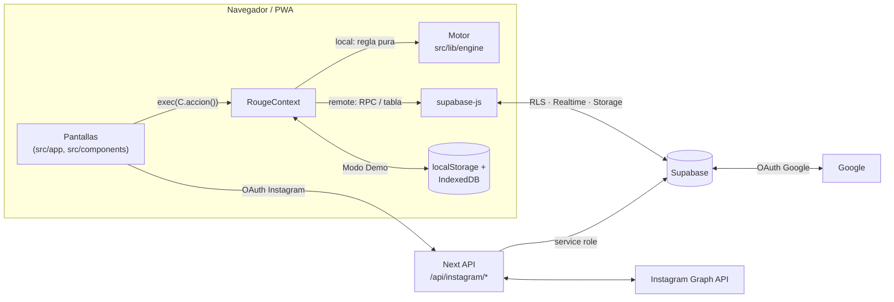
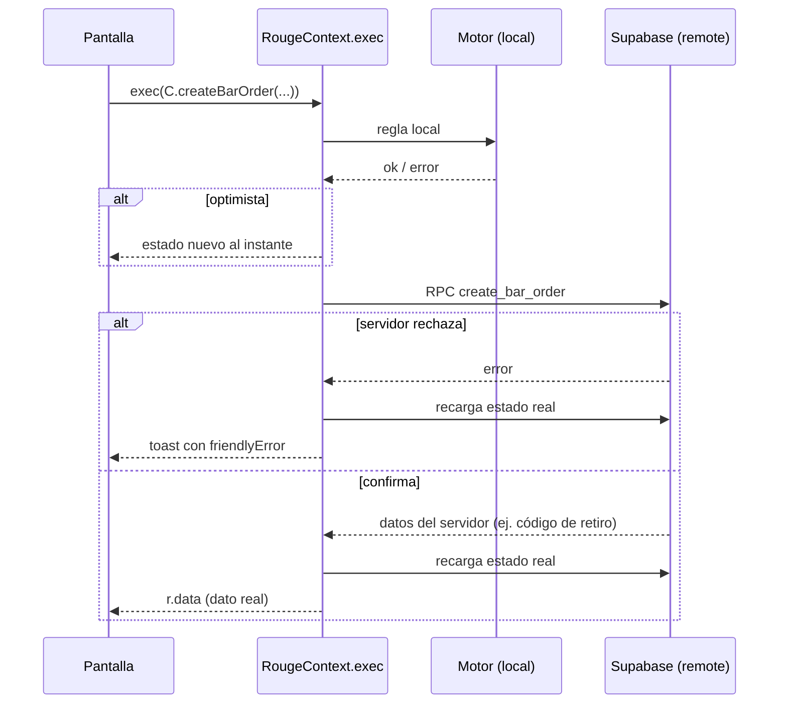
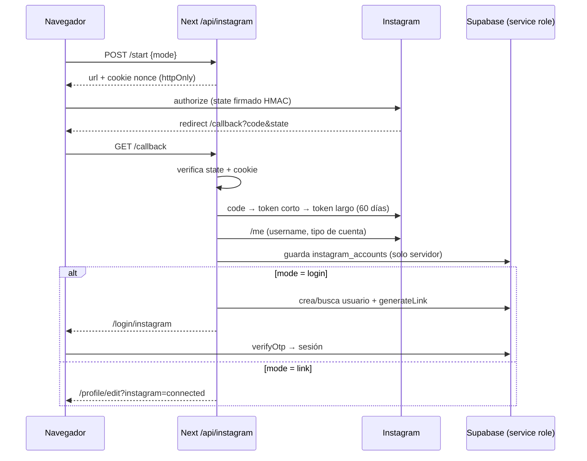

# Arquitectura

> Para agentes de código y convenciones finas, ver también [`CLAUDE.md`](../../CLAUDE.md).

## Stack

| Capa | Tecnología |
|---|---|
| Framework | Next.js 16 (App Router, Turbopack) · React 19 · TypeScript estricto |
| Estilos | Tailwind CSS 3.4 + `tailwindcss-animate`, primitivas estilo shadcn (`src/components/ui`) |
| Backend | Supabase: Postgres + Auth + Storage + Realtime (`supabase/schema.sql`) |
| Servidor propio | Route Handlers de Next (`src/app/api/instagram/*`) solo para el OAuth de Instagram |
| Media | `browser-image-compression` (WebP en el cliente), MediaRecorder para el loop sin audio |
| QR | `qrcode.react` |
| Tests | Vitest (unitarios, contrato, integración real) + Playwright (E2E en `e2e/`) |

## Vista general



## Principios

1. **Motor puro primero.** Toda regla de negocio vive en `src/lib/engine/*` como funciones puras
   `(state, input, now) → { ok, state, data } | { ok: false, error }`. Las pantallas nunca implementan reglas.
2. **Comandos** (`src/lib/store/commands.ts`): cada acción se define una vez con
   - `local`: la regla del motor (valida y produce el estado nuevo; mismos mensajes de error),
   - `remote`: su contraparte en Supabase (RPC o tabla con RLS),
   - `optimistic: false` cuando el servidor genera el resultado (códigos de Squad, de retiro, de 1 uso, ganador del
     sorteo, ingreso): la UI nunca muestra un dato inventado en el cliente.
3. **`exec()`** en `RougeContext`: aplica `local` al instante (UI optimista), llama a `remote` y, si el servidor
   rechaza, recarga el estado real y muestra un error amigable (`friendlyError`). Tras confirmar, recarga antes de resolver.
4. **Misma semántica en demo y en Supabase.** Cada regla tiene su espejo en SQL. Si se cambia una, se cambian ambas
   y los tests (`commands.test.ts` verifica nombres de RPC, parámetros, tablas y columnas contra `schema.sql`).
5. **Un solo estado** (`RougeState`, `src/lib/types.ts`, espejo 1:1 del esquema). Demo y Supabase producen la misma forma.

## Flujo de una acción



## Modos de datos

**Modo Demo** (sin credenciales): `createSeedState(now)` siembra una fiesta en vivo (fechas relativas a "ahora"),
persistida en `localStorage` (`rouge:state`). Fotos y videos en IndexedDB (`idb:<uuid>`). Dos pestañas se sincronizan
por el evento `storage`. La persona activa es **por pestaña** (`sessionStorage`). Si cambia el formato, se sube
`STATE_VERSION` en `seed.ts` y se re-siembra.

**Modo Supabase:**
- Sesión con link mágico, Google u Instagram. `current_user_id = auth.uid()`.
- `fetchRemoteState()` (`src/lib/supabase/sync.ts`) arma el estado con selects filtrados por RLS. El teléfono propio
  llega por `my_profile()`, el CRM por `event_crm()`, las métricas del staff por `event_stats()`, mi Instagram por `my_instagram()`.
- Re-sincroniza por **Realtime** (con debounce), al enfocar la ventana y cada 45 s.
- `signedIn` se publica **junto** con el estado de ese usuario (evita decidir "sin perfil" antes de cargar).

## Roles y permisos

`src/lib/engine/roles.ts` define los roles (`owner`, `manager`, `bartender`, `waiter`, `security`, `attendee`) y
`ROLE_PERMISSIONS`. Su espejo en SQL son `has_staff_role`, `is_event_manager` y `can_operate_bar`, que usan las RPCs y
las políticas RLS. Los comandos de staff se envuelven con `guarded(perm, …)`. `AdminChrome` filtra el menú y muestra
"sin acceso". `destinationFor()` decide a qué pantalla va cada uno al entrar.

## Login social

- **Google:** `supabase.auth.signInWithOAuth({ provider: "google" })`, vuelve a `/login`.
- **Instagram** (Supabase no lo trae): OAuth propio.



Importar fotos: `GET /api/instagram/media` lista el feed y `POST` descarga una foto (solo hosts de Meta) que el
cliente pasa por `compressImage → uploadMedia`.

## Estructura de carpetas

```
src/app/            rutas (App Router): landing, /app, /login, lobby, squad, map, bar, perks, chats, /admin/*, /api/instagram/*
src/components/     ui · layout · profile · lobby · chat · squad · perks · share · social · landing · admin · venue · event
src/lib/engine/     reglas puras: actions, selectors, roles, affinity, grid, bar, profile, analytics
src/lib/store/      RougeContext (estado + exec), commands (local + remote), hooks
src/lib/supabase/   client, sync (carga + Realtime), errors (mensajes)
src/lib/social/     Google / Instagram desde el navegador
src/lib/instagram/  OAuth y Graph API (servidor)
src/lib/media/      compresión, IndexedDB, subida
src/lib/mock/       datos del Modo Demo
supabase/           schema.sql (todo el backend) · seed.sql (evento de prueba)
e2e/                pruebas de navegador (Playwright) + mock de Instagram
scripts/            íconos, avatares demo, capturas de la landing
```

## Decisiones de diseño relevantes

- **Hidratación solo en cliente:** la semilla depende de `Date.now()`; el provider muestra un BootScreen hasta montar.
- **Una sola interfaz:** las rutas de usuario se ven dentro de un contenedor de teléfono (`max-w-md`) también en
  desktop; `/admin/*` y la landing usan ancho completo.
- **Media fuera del estado:** nunca data URLs en el estado; `uploadMedia()` devuelve URL de Storage o ref `idb:`.
- **Baja señal:** todo se comprime antes de subir, placeholders de color, Spotify diferido, Service Worker.
- **Guardado sincrónico** en demo (flush en `pagehide`): una acción nunca se pierde al cerrar la PWA.
